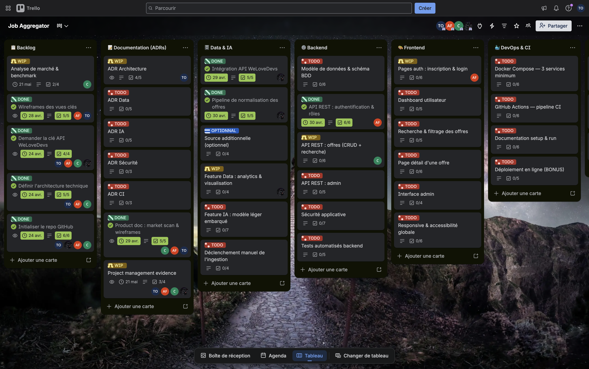

# Project Management

## Team

| Member                       | Role                     |
| ---------------------------- | ------------------------ |
| Tom Ostermann (TO)           | Tech Lead / DevOps & CI  |
| Arthur Fabbri (AF)           | Backend & Data           |
| Christophe Rajaonarivoni (C) | Frontend & Product       |
| Imran Nogueira               | Frontend & Documentation |

## Tracking Tool

We use Trello as our project management tool.
Board: https://trello.com/invite/b/69ce80d4d85dc15495858abd/ATTI44c7854914fa533edaf470f47795585bED4D7D07/job-aggregator

The board is organized into the following columns:
**Backlog / Documentation (ADRs) / Data & IA / Backend / Frontend / DevOps & CI**

Each card is assigned to one or more members and includes a checklist
tracking subtasks completion.

> Note: The team works Monday to Thursday, giving an effective
> 5-week sprint calendar between April 20 and May 21.

---

## Sprints

### Sprint 1 — Discovery & Product Foundation (20/04 → 24/04)

**Goal:** Understand the market, align on the product vision, and set up the project base.

| Task                                | Owner                   | Status  |
| ----------------------------------- | ----------------------- | ------- |
| Market analysis & benchmark         | Christophe              | ✅ Done |
| Identify user pain points           | Christophe              | ✅ Done |
| Define value proposition            | Christophe              | ✅ Done |
| Wireframes for key views            | Arthur, Tom             | ✅ Done |
| Define technical architecture       | Tom, Arthur, Christophe | ✅ Done |
| Initialize GitHub repository        | Tom, Arthur, Christophe | ✅ Done |
| Request WeLoveDevs API key          | Tom, Arthur, Christophe | ✅ Done |
| Initial task breakdown & assignment | All                     | ✅ Done |

---

### Sprint 2 — Core Implementation (28/04 → 08/05)

**Goal:** Build the data pipeline, core backend routes, and start documentation.

| Task                                    | Owner                   | Status  |
| --------------------------------------- | ----------------------- | ------- |
| WeLoveDevs API integration              | Arthur                  | ✅ Done |
| Offer normalization pipeline            | Arthur                  | ✅ Done |
| REST API: authentication & roles        | Arthur                  | ✅ Done |
| API REST: offers CRUD + search          | Christophe              | 🔄 WIP  |
| Database schema & model                 | Arthur                  | 📋 Todo |
| ADR Architecture                        | Tom                     | 🔄 WIP  |
| Product doc: market scan & wireframes   | Christophe, Arthur, Tom | ✅ Done |
| Data feature: analytics & visualisation | —                       | 🔄 WIP  |

---

### Sprint 3 — Frontend & Features (09/05 → 15/05)

**Goal:** Build the user-facing interface and integrate data/AI features.

| Task                                   | Owner  | Status  |
| -------------------------------------- | ------ | ------- |
| Auth pages: register & login           | Arthur | 📋 Todo |
| User dashboard                         | —      | 📋 Todo |
| Offer search & filtering               | —      | 📋 Todo |
| Offer detail page                      | —      | 📋 Todo |
| Admin interface                        | —      | 📋 Todo |
| Responsive & accessibility             | —      | 📋 Todo |
| AI feature: lightweight embedded model | —      | 📋 Todo |
| Manual ingestion trigger               | —      | 📋 Todo |
| REST API: admin                        | —      | 📋 Todo |

---

### Sprint 4 — Security & CI (16/05 → 19/05)

**Goal:** Harden the platform, automate CI, and finalize DevOps setup.

| Task                        | Owner | Status  |
| --------------------------- | ----- | ------- |
| Application security        | —     | 📋 Todo |
| Backend automated tests     | —     | 📋 Todo |
| GitHub Actions CI pipeline  | Tom   | 📋 Todo |
| Docker Compose — 3 services | Tom   | 📋 Todo |
| Documentation setup & run   | —     | 📋 Todo |
| Optional: online deployment | Tom   | 📋 Todo |

---

### Sprint 5 — Documentation & Polish (20/05 → 21/05)

**Goal:** Finalize all ADRs, project management evidence, and prepare the final presentation.

| Task                           | Owner                   | Status  |
| ------------------------------ | ----------------------- | ------- |
| ADR Data                       | Tom                     | 📋 Todo |
| ADR IA                         | Tom                     | 📋 Todo |
| ADR Sécurité                   | —                       | 📋 Todo |
| ADR CI                         | —                       | 📋 Todo |
| Project management evidence    | Tom, Arthur, Christophe | 🔄 WIP  |
| Final presentation preparation | All                     | 📋 Todo |

---

## Timeline Overview

```
20/04   24/04   08/05   15/05   19/05   21/05
  |-------|-------|-------|-------|-------|
  Sprint1  Sprint2  Sprint3  Sprint4  Sprint5
Discovery  Core    Frontend  Security  Docs &
& Setup   Impl.   & Features & CI     Polish
```

---

## Legend

- ✅ Done
- 🔄 WIP (Work In Progress)
- 📋 Todo

## Board Screenshot


